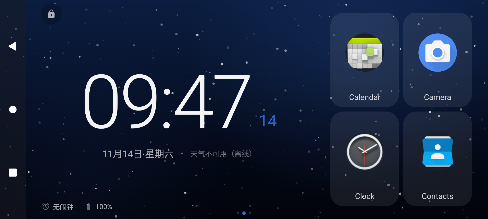
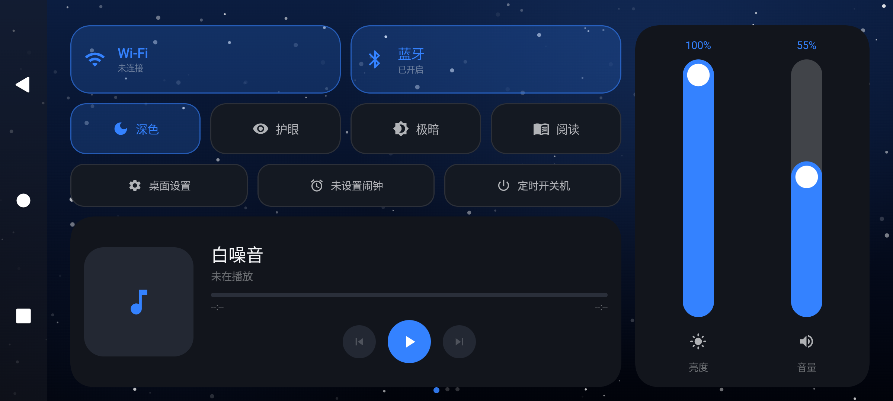
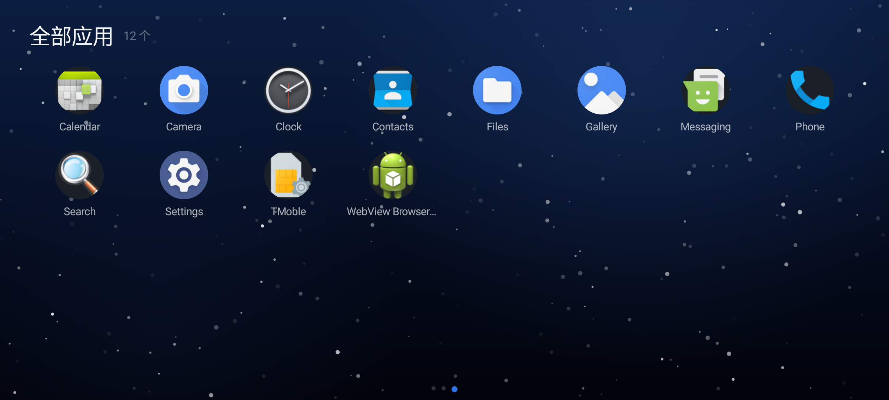
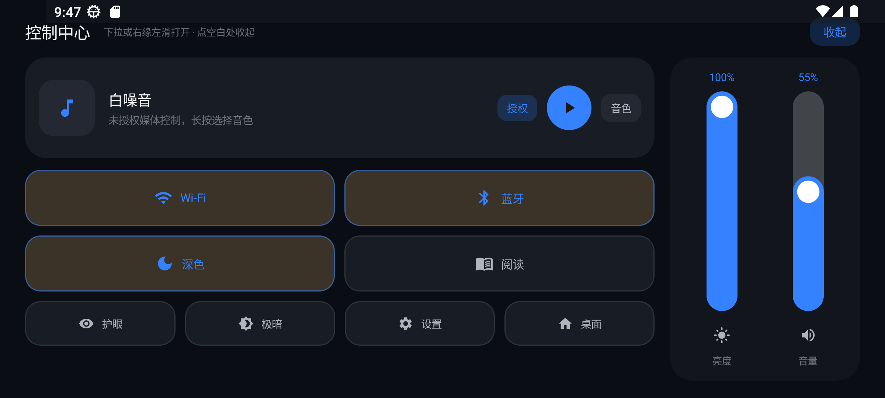
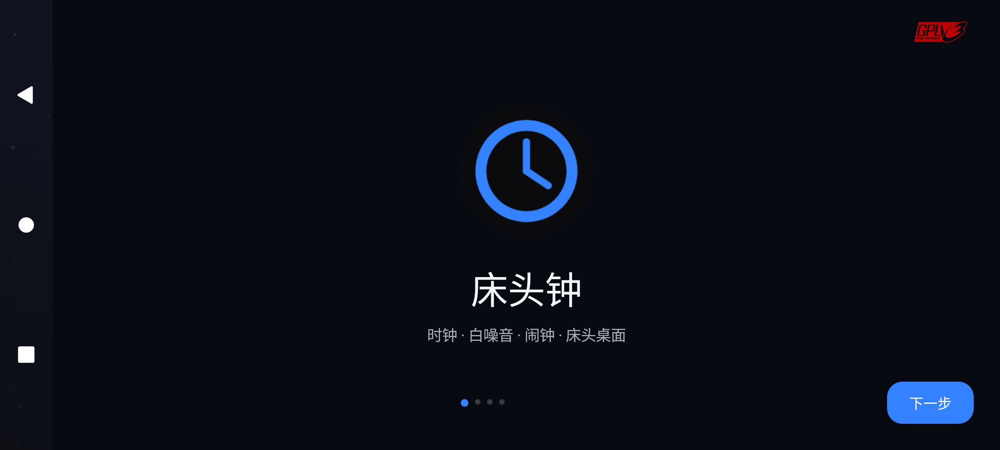
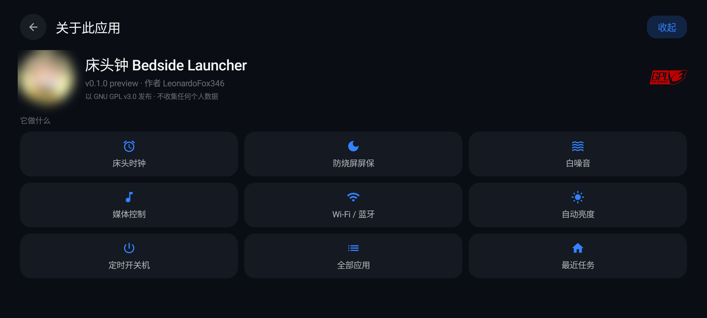
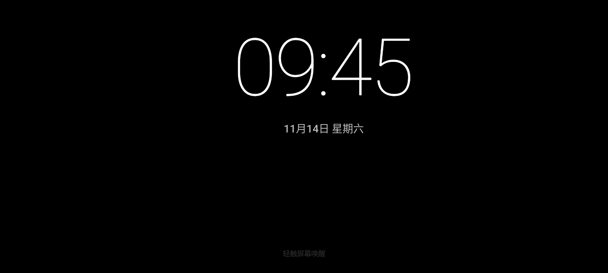

# 床头钟 · BedsideLauncher

把闲置的 Android 手机变成一台 **床头时钟 + 白噪音机 + 闹钟 + 横屏桌面**。

[](LICENSE)
[](#兼容性)
[](#构建)
[](docs/demo/demo-home.png)



## 它是什么

横屏锁定的桌面替代品：左侧大时钟 / 日期 / 天气，右侧常用应用；下拉是自绘控制中心，底部上滑是最近任务；无操作一段时间后由系统 DreamService 拉起防烧屏屏保。所有界面都不调用系统设置页，Wi‑Fi、蓝牙、媒体、闹钟都在应用内完成。

## 功能

### 桌面
- **三页布局**：设置页 / 主页 / 全部应用，左右滑动切换。
- **主页**：大时钟、日期、天气（Open-Meteo），4 个可长按替换的应用入口，底部闹钟与电量。
- **全部应用**：应用网格，图标统一圆形。
- **状态栏**：全隐藏 / 仅导航栏 / 仅状态栏 / 全部显示四档，默认只显示导航栏。
- **全设备强制横屏**（可选，需要 Root）。
- **返回逻辑**：浮层 → 设置 → 主页 → 留在应用内；系统 Home 键回到中间主页。
- **最近任务**：底部上滑打开，长按卡片或点右上角 × 结束该应用后台（Root 下走 `am force-stop`，会一并停掉服务、广播与推送），也可「结束全部」。

### 控制中心
- 顶部下拉或右缘左滑打开；媒体卡片（封面 / 进度 / 上一首 / 暂停 / 下一首）、功能磁贴、竖版亮度与音量滑条。
- 白噪音卡片长按进入音色二级菜单。

### 白噪音
- 白噪音 / 粉红 / 棕色 / 雨声 / 海浪，五种程序化合成音色。
- 睡眠定时、前台服务播放、锁屏继续。

### 屏幕保护
- 注册为系统 DreamService，系统休眠时自动拉起；应用内无操作也会进入。
- 白色细体大字，**整组时钟每 40 秒淡出、随机换位再淡入**（防烧屏），3 分钟后自动变暗，进入时亮度压到 1%。

### 设置与工具
- **定时开关机**：多组关机 / 开机时间，时钟滚轮选择；关机前写入 RTC 唤醒。
- **免 Root 锁屏**：无障碍服务调用 `GLOBAL_ACTION_LOCK_SCREEN`。
- **Wi‑Fi / 蓝牙**：自绘扫描、连接、配对列表；无 Root 时开关自动降级到系统设置页。
- **媒体控制**：通过通知使用权读取系统媒体会话。

## 截图

| 设置页 | 全部应用 |
|---|---|
|  |  |

| 控制中心 | 首次引导 |
|---|---|
|  |  |

| 关于 | 屏保 |
|---|---|
|  |  |

## 下载

- [`dist/BedsideLauncher-1.0.2.apk`](dist/BedsideLauncher-1.0.2.apk) — **v1.0.2 正式版**（release 签名，约 43 MB）

> 签名证书 SHA-256：`c11e265dde34bc7ebba3644b63102804eab243c38c9b7b6cac1e4d5f4fa87783`。
> 自带的 debug 预览版已不再提供，请使用上面的正式版。

## Root 模块（Magisk / KernelSU）

[`dist/bedside-launcher-module-v1.0.2.zip`](dist/bedside-launcher-module-v1.0.2.zip) — 通用 Magisk / KernelSU 模块，刷入重启后自动：

- 把「床头钟」设为默认桌面
- 授予最近任务的用量访问、通知使用权、无障碍锁屏
- 加入电池优化白名单
- 可选停用原生桌面（`DISABLE_STOCK=1`，会连同它的多任务提供者一起让出）

配置在 `/data/adb/modules/bedside_launcher/config.env`，卸载模块会自动恢复原生桌面。详见 [magisk-module/README.md](magisk-module/README.md)。

> 模块只使用 Android 自带命令（`pm` / `cmd` / `settings` / `appops` / `dumpsys`），不依赖 Magisk 专有工具，KernelSU 与 Magisk 均可使用。

## 反馈

- 遇到 Bug 或有建议：[提交 Issue](https://github.com/LeonardoFox346/BedSiteLauncher/issues/new/choose)
- 应用内入口：「桌面设置 → 问题反馈 Issue / 源码仓库」

## 兼容性

| 项目 | 值 |
|---|---|
| 系统 | Android 11+（minSdk 30，targetSdk 36） |
| 屏幕 | 横屏设计，已适配 1080×2400 AMOLED |
| Root | 可选（KernelSU / Magisk），未授权时相关功能自动降级 |

## 构建

需要 JDK 21+（推荐 Android Studio 自带 JBR）与 Android SDK（compileSdk 37）。

```bash
export JAVA_HOME="/path/to/Android Studio/jbr"
./gradlew assembleDebug
# 产物：app/build/outputs/apk/debug/app-debug.apk
```

> 项目路径含中文时已启用 `android.overridePathCheck=true`；若 Gradle 仍报路径问题，可用纯英文 junction 指向本项目再构建。

## 安装

### 方式一：Magisk / KernelSU 模块（推荐，已 Root）

刷入 [`dist/bedside-launcher-module-v1.0.2.zip`](dist/bedside-launcher-module-v1.0.2.zip) 并重启即可：自动设为默认桌面、授予最近任务/通知使用权/无障碍，可选停用原生桌面与它的多任务提供者。配置见 [magisk-module/README.md](magisk-module/README.md)。

### 方式二：adb 手动安装

```bash
adb install -r app-debug.apk

# 设为默认桌面
adb shell cmd package set-home-activity com.leonardofox.bedside/.MainActivity

# 最近任务需要用量访问（可选）
adb shell appops set com.leonardofox.bedside GET_USAGE_STATS allow

# 免 Root 锁屏需要开启无障碍（可选）
adb shell settings put secure enabled_accessibility_services \
  com.leonardofox.bedside/.system.LockAccessibilityService
adb shell settings put secure accessibility_enabled 1
```

首次启动会有 4 步引导：欢迎 → 权限（通知使用权 / 定位 / Root / 默认桌面）→ 桌面设定 → 欢迎进入；权限卡片会按实际授权状态自动打钩，必须勾选同意隐私政策才能继续。

## 权限与隐私

**不收集、不上传任何个人数据**，没有账号、没有统计 SDK，所有设置只存在本机。

| 权限 | 用途 |
|---|---|
| 网络 / 网络状态 | 获取天气（Open-Meteo，仅发送所选经纬度） |
| 附近 Wi‑Fi 设备 / 定位 | 扫描、连接 Wi‑Fi；无 Root 时回落到系统 WifiManager |
| 蓝牙连接 / 扫描 | 读取已配对设备并尝试连接 |
| 通知使用权 | 读取媒体会话（上/下一首、暂停），**不读取通知内容** |
| 精确闹钟 / 通知 / 前台服务 | 白噪音播放、屏保、定时任务 |
| 无障碍服务（可选） | 仅用于一键锁屏，**不读取屏幕内容、不监听输入** |
| Root（可选） | Wi‑Fi/蓝牙切换、自动亮度、强制横屏、定时关机、设置系统屏保 |

完整说明见应用内「桌面设置 → 隐私政策」。

## 目录结构

```
app/src/main/java/com/leonardofox/bedside/
├── MainActivity.kt        # 入口，沉浸式、Home 意图
├── ui/                    # Compose 界面：Root / DeskPage / Pages / Panels / Overlays / Onboarding / About
├── data/                  # Prefs、应用仓库、最近任务、天气
├── system/                # RootShell、SysUi、Wi‑Fi/蓝牙、闹钟、锁屏
├── media/                 # 媒体会话读取
├── audio/                 # 白噪音前台服务
├── alarm/                 # 闹钟调度
├── power/                 # 定时开关机 + RTC 唤醒
└── dream/                 # 系统屏保 DreamService
```

## 已知限制

- 天气依赖网络与 Open-Meteo，无网络时显示缓存或占位。
- 部分功能（Wi‑Fi 切换、蓝牙开关、亮度、强制横屏、关机）需要 Root，未授权时自动降级。
- 本仓库的 APK 为 debug 构建，体积较大。

## 许可证

以 **GNU General Public License v3.0** 发布，完整文本见 [LICENSE](LICENSE)。
GPLv3 徽标随应用显示在引导页、关于页与隐私政策页。

作者：**LeonardoFox346** · 头像为作者原创稿件，应用内以编码方式存放，请勿提取使用。